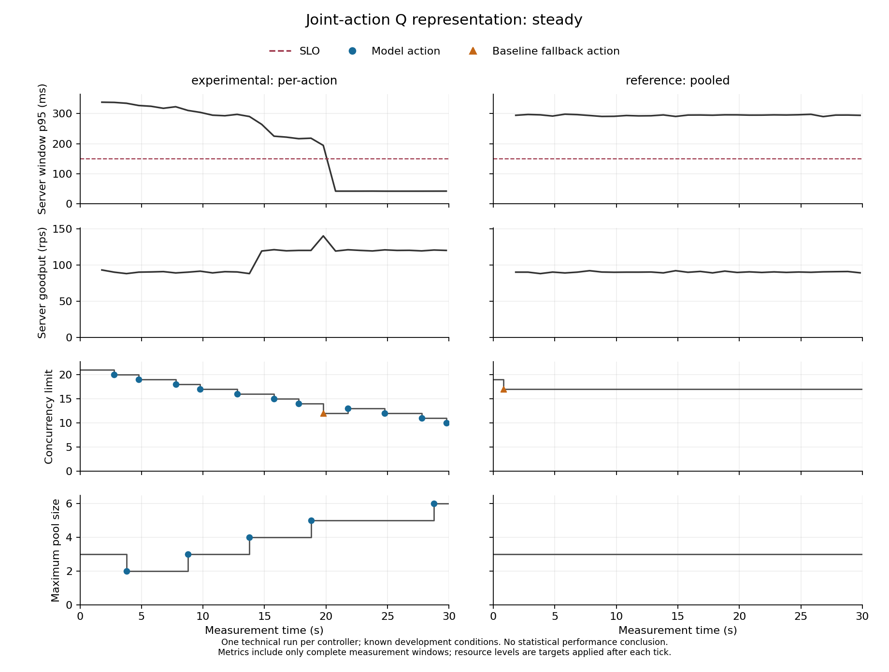
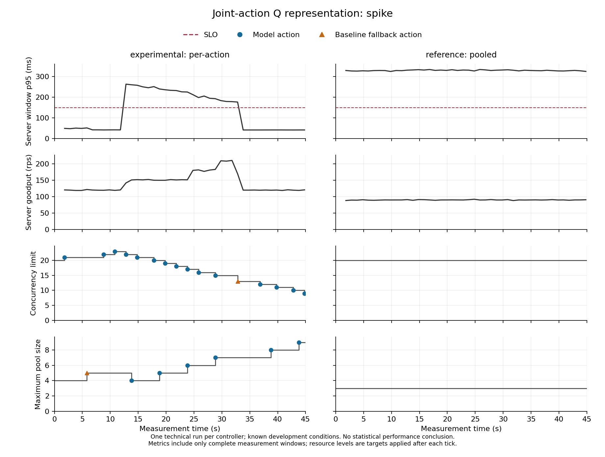

# Замкнутый контроль Q по совместным действиям

Четыре технических эпизода от 8 ноября 2026 года на чистом `2fa8fac`. [Модели](../../models/fqi-action-conditioned-2026-11-08/README.md) обучены на чистом `3c64f21`; SHA каждого файла проверялся перед запуском и сохранён в metadata. Порядок зафиксирован до обучения: steady/experimental, steady/reference, spike/reference, spike/experimental. **Experimental** — per-action JSON v2; **reference** — общий pooled JSON v1. Это сравнение представлений без выбора победителя по Bellman RMSE; результаты предыдущего отбора моделей не меняются.

Объект одинаковый: 8 воркеров, обслуживание 30 мс, исходный пул 2 (границы 2–12), исходный лимит 20, SLO 150 мс, окно 1 с, pool period 5. Режим learned с явным разрешением прототипа, бюджет 20 мс, обычные guardrails и baseline fallback. Каждый эпизод — отдельная JVM, прогрев 6 с; сон блокировался `caffeinate -i`. Полные свойства, роли и порядок — в `execution.json` и [плане](../../models/fqi-action-conditioned-2026-11-08/technical-check-plan.json).

Валидатор проверил **4 эпизода / 180 записей / 142 полных измерительных перехода**, без нерегулярных интервалов. Все четыре конечные записи сохранены. Все **158 решений моделей** и **6 support fallback** совпали с Python; желаемые и применённые ресурсы модели совпали.

## Действия контроллеров

Счётчики решений охватывают всю запись, включая прогрев; нагрузочные показатели ниже относятся к измерительной фазе.

| Профиль | Вариант | Решений модели | Изменений L | Изменений P | Одновременных L и P | Hold | Начальные / support fallback |
|---|---|---:|---:|---:|---:|---:|---:|
| steady | per-action | 32 | 13 | 5 | 0 | 14 | 4 / 1 |
| steady | pooled | 32 | 0 | 0 | 0 | 32 | 4 / 2 |
| spike | pooled | 48 | 0 | 0 | 0 | 48 | 4 / 0 |
| spike | per-action | 46 | 17 | 7 | 2 | 24 | 4 / 3 |

Обученная per-action политика выполнила **30 изменений лимита и 12 изменений пула**, включая **2 совместных изменения**. Это решения Q-модели с причиной `learned_policy`, а не действия baseline. Всего у экспериментального варианта 78 решений; одновременные изменения учитываются в обоих ресурсных столбцах. Pooled по-прежнему только удерживал ресурсы.

Все изменения обеих моделей проходят исходные guardrails. Ошибок модели и превышений кооперативного бюджета не зарегистрировано. Среднее/максимальное inference: per-action steady **0.594/3.542 мс**, spike **0.407/2.735 мс**; pooled steady **0.822/9.450 мс**, spike **0.645/9.272 мс**. Эти замеры не дают гарантии реального времени и не являются сравнением вычислительной эффективности при равной сложности моделей.

## Нагрузочные показатели

| Профиль | Вариант | Goodput, rps | Клиентский p95, мс | p99, мс | Успешные вне SLO, % | 429, % |
|---|---|---:|---:|---:|---:|---:|
| steady | per-action | 106.9 | 323 | 333 | 56.8 | 10.9 |
| steady | pooled | 90.8 | 295 | 298 | 98.5 | 24.4 |
| spike | pooled | 90.6 | 331 | 334 | 98.9 | 62.9 |
| spike | per-action | 142.0 | 242 | 258 | 52.5 | 41.9 |

Результат смешанный. На spike у нового варианта выше goodput и ниже p95/p99, но на steady p95/p99 хуже, несмотря на рост goodput и меньшую долю нарушений SLO. Нарушений SLO всё ещё много. Нельзя приписывать все изменения производительности только Q-модели: в обоих вариантах действует baseline fallback. Это известные development-условия, отдельные JVM и один повтор на вариант/профиль; статистическое превосходство, устойчивость и перенос на PostgreSQL не установлены. Параметры после просмотра этих эпизодов не менялись.

## Наблюдавшиеся траектории

На графиках — серверный p95 по полным окнам (он отличается от клиентского агрегатного p95 таблицы), goodput и применённые ресурсы. Синие точки обозначают действия модели, оранжевые — baseline. Ресурсы при t=0 взяты из metadata начала измерения; временная отметка действия приближена временем snapshot.





Также сохранены SVG. Графики показывают конкретные временные ряды и переходный процесс, не причинное доказательство и не доверительные интервалы.

## Воспроизведение и аудит

```bash
python3 docs/benchmark/tools/audit_controller_comparison.py \
  docs/benchmark/raw/action-conditioned-control-2026-11-08 \
  docs/benchmark/models/fqi-action-conditioned-2026-11-08 \
  --plan docs/benchmark/models/fqi-action-conditioned-2026-11-08/technical-check-plan.json \
  --out /tmp/iasr-action-control-audit.json
python3 -m pip install -r docs/benchmark/tools/requirements-plot.txt
python3 docs/benchmark/tools/plot_controller_trajectories.py \
  docs/benchmark/raw/action-conditioned-control-2026-11-08 \
  --scenario spike --out /tmp/iasr-action-spike.png
```

Новый запуск JVM использует `BenchmarkRunner` отдельно по каждому случаю из плана: `bench.modes=learned`, `bench.repeat=1`, нужный `bench.scenarios`, `bench.allowPrototype=true`, SHA-проверенный `bench.model` и свойства плана. В сохранённом запуске использовались текущие reactor-классы напрямую через `java --class-path`; Maven-вариант — в [инструкции JVM](../../../dissertation/jvm-policy.md). Все результаты и журналы сохранены, включая действия baseline.
