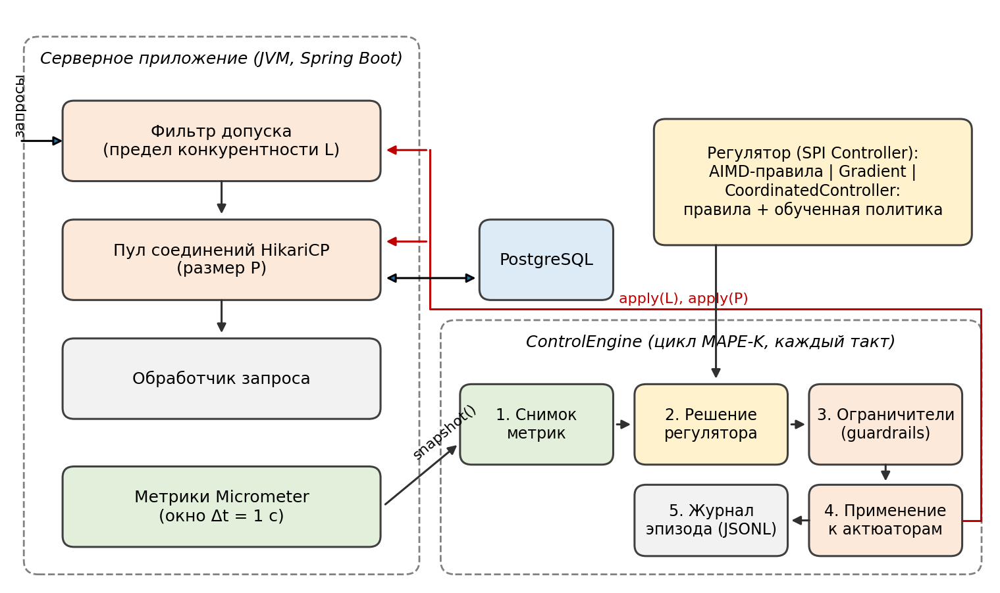

# ГЛАВА 3. АРХИТЕКТУРА И ПРОГРАММНАЯ РЕАЛИЗАЦИЯ

## 3.1. Требования и общая структура

Метод, описанный в главе 2, реализован в виде библиотеки IASR для приложений на платформе JVM и конвейера обучения на языке Python. К реализации предъявлялись следующие требования.

1) Встраиваемость: управляющий контур работает внутри процесса приложения и подключается зависимостью и свойствами конфигурации, без изменения кода обработчиков запросов.

2) Расширяемость: регулятор, источник метрик и актюаторы заменяемы через интерфейсы поставщика услуг (SPI); обученная политика — одна из реализаций регулятора.

3) Безопасность: любое решение проходит через общий слой ограничений; при ошибке, нехватке данных или исчерпании бюджета времени решение принимает базовый регулятор.

4) Наблюдаемость и воспроизводимость: каждый такт записывается в журнал эпизода с причиной решения; модель обучается побайтово воспроизводимо, а решения JVM совпадают с эталонной реализацией Python.

5) Низкие накладные расходы: решение обученной политики занимает единицы миллисекунд при окне управления в одну секунду.

Библиотека состоит из модулей, перечисленных в таблице [@tbl:modules]. Общая схема взаимодействия компонентов показана на рисунке [@fig:arch].

Таблица: Модули библиотеки IASR {#tbl:modules}
| Модуль | Назначение | Основные классы |
|---|---|---|
| iasr-core | управляющий контур, SPI, базовый регулятор, ограничители, единое описание ресурса, журнал | `ControlEngine`, `Controller`, `Actuator`, `MetricsProvider`, `BaselineController`, `Guardrails`, `SoftResource`, `CoordinatedActionSpace`, `DatasetLogger` |
| iasr-micrometer | источник метрик на основе Micrometer | `MicrometerMetricsProvider`, `IasrMeterBinder` |
| iasr-policy | обучаемые политики: согласованная политика версии 3 и прототип | `CoordinatedController`, `PolicyModel`, `PolicyFeatures` |
| iasr-spring-boot-starter | автоконфигурация Spring Boot 3, фильтр допуска | `IasrAutoConfiguration`, `IasrProperties`, `ConcurrencyLimitFilter` |
| iasr-benchmark | нагрузочный стенд, сценарии, исследующие политики, базовая линия Gradient | `BenchmarkRunner`, `LoadGenerator`, `CoordinatedExplorer`, `GradientController` |
| iasr-learning (Python) | сбор эпизодов, обучение, эталонные решения, парное сравнение | `features`, `dataset`, `fqi`, `train`, `compare`, `tools/stand.py` |

{#fig:arch width=16.5}

Объём исходного кода Java составляет около 7,5 тыс. строк в основных модулях, Python — около 1,1 тыс. строк. Библиотека покрыта 235 модульными и интеграционными тестами Java, конвейер обучения — 18 тестами Python.

## 3.2. Управляющий контур и интерфейсы расширения

Ядро библиотеки — класс `ControlEngine`, реализующий цикл MAPE-K. Он запускается планировщиком с периодом окна управления и на каждом такте выполняет пять шагов:

1) снимок метрик — получение `MetricsSnapshot` от `MetricsProvider` и дополнение его служебными величинами: номером такта, фактической длительностью окна и оставшимся периодом охлаждения каждого актюатора;

2) решение регулятора — вызов `Controller.decide(snapshot, actuators)`, возвращающего желаемые значения ресурсов и причину решения для каждого;

3) ограничения — `Guardrails.enforce(...)` применяет к решению цепочку ограничителей каждого ресурса (охлаждение, блокировка увеличения при нарушении SLO, шаг, диапазон) и дополняет причины информацией о сработавшем ограничении;

4) применение — вызов `Actuator.apply(value)` для каждого изменившегося ресурса;

5) журнал — запись состояния, применённых значений, намерения регулятора до ограничений, значений ресурсов до решения и оставшихся периодов охлаждения.

Ошибка любого шага не останавливает контур: она записывается в журнал приложения, а ресурсы остаются прежними. В режиме наблюдения (`apply-actions: false`) шаги 2–4 не выполняются, и контур только пишет журнал; этот режим соответствует статическому пределу в экспериментах.

Интерфейсы расширения минимальны:

```
public interface Controller {
    ControlAction decide(MetricsSnapshot snapshot, List<Actuator> actuators);
}
public interface Actuator {
    String name(); int currentValue(); void apply(int newValue);
    int minValue(); int maxValue();
}
public interface MetricsProvider {
    MetricsSnapshot snapshot();
}
```

Минимальность интерфейса регулятора позволила подключить к контуру сторонний алгоритм — Gradient из библиотеки Netflix — как обычную реализацию SPI (`GradientController` в модуле стенда) и сравнивать его с собственными регуляторами в одинаковых условиях. Обученная политика также реализует этот интерфейс и не требует от контура никаких особых путей исполнения.

Реализованы два актюатора. `ConcurrencyLimiter` — семафор с изменяемым числом разрешений. Увеличение предела освобождает разрешения сразу; уменьшение создаёт «долг» разрешений, погашаемый по мере завершения запросов, что позволяет снижать предел без прерывания обработки. Фильтр `ConcurrencyLimitFilter` ожидает разрешения в течение заданного времени и при неудаче отвечает кодом 429 Too Many Requests; служебные пути (проверки работоспособности) обходят фильтр. `HikariPoolActuator` меняет максимальный размер пула HikariCP во время работы через интерфейс управления `HikariConfigMXBean`, без пересоздания источника данных.

## 3.3. Контракт метрик

Решения регуляторов и обучение зависят от того, как определены метрики. Поэтому их семантика зафиксирована контрактом, проверяемым регрессионными тестами. Основные положения контракта:

- полезная пропускная способность `goodput_rps` — число успешных бизнес-ответов (2xx) за окно, делённое на фактическую длительность окна; ответы 429, 5xx и исключения не являются успешными;
- задержка успешного запроса измеряется от входа в фильтр допуска до завершения цепочки фильтров и включает ожидание разрешения: total = admission_wait + service; перцентили вычисляются по сумме для каждого запроса, а не складываются по составляющим;
- `slo_good_fraction` — доля успешных ответов окна, общее время которых не превысило SLO; эта метрика введена в версии 3 для вычисления вознаграждения [@eq:reward];
- `timeout_rate` и `error_rate` — доли отклонённых и ошибочных исходов среди всех завершённых за окно запросов;
- `dependency_mean_ms` — оценка времени удержания соединения как разность среднего времени обслуживания и среднего времени получения соединения; это остаток, а не точное время SQL-запроса;
- первое окно эпизода использует условную длительность и исключается из обучения.

Метрики собираются модулем `iasr-micrometer`. `IasrMeterBinder` регистрирует собственные счётчики запросов, успешных ответов, отклонений и ошибок, а `WindowedLatencyTracker` накапливает задержки успешных запросов окна и вычисляет перцентили, средние составляющие и долю ответов в пределах SLO. `MicrometerMetricsProvider` формирует снимок, используя монотонное время реестра метрик {micrometer}.

Контракт метрик отражает урок предыдущего этапа: при изменении определения goodput или задержки меняются решения регуляторов, поэтому архивы с прежней семантикой не объединяются с новыми данными для обучения; версия схемы записывается в каждый эпизод.

## 3.4. Единое описание ресурса и пространство действий в ядре

Единое описание мягкого ресурса реализовано в ядре как неизменяемая запись:

```
public record SoftResource(String actuatorName, String usageMetric,
        String backlogMetric, String waitMetric, String holdMetric) {
    public static final SoftResource CONCURRENCY = new SoftResource(
        "concurrency_limit", "inflight", "queue_length",
        "admission_wait_mean_ms", "service_mean_ms");
    public static final SoftResource CONNECTION_POOL = new SoftResource(
        "hikari_max_pool", "hikari_active", "hikari_pending",
        "hikari_acquire_mean_ms", "dependency_mean_ms");
}
```

Уровень действия `ActionLevel(relative, minStep)` вычисляет приращение по формуле [@eq:level]. Класс `CoordinatedActionSpace` объединяет управляемые ресурсы — тройки (описание ресурса, ограничитель, уровни) — и предоставляет четыре операции: текущие ёмкости; множество допустимых целей ресурса с учётом охлаждения, блокировки при нарушении SLO, шага и диапазона; декартово произведение целей с удержанием на первом месте; ограничение произвольного желаемого значения так, как его ограничил бы слой ограничителей. Последняя операция повторяет цепочку `Guardrails` и используется для вычисления опорной конфигурации. Её совпадение с фактическим поведением ограничителей проверяется тестами.

Пространство действий используется тремя компонентами: исследующей политикой стенда, обученной политикой и (в виде двойника на Python) конвейером обучения. Поэтому любое расхождение между ними обнаруживается тестами согласованности, а не на стенде.

## 3.5. Журнал эпизода

При включённом журнале каждый такт записывается строкой JSONL (схема версии 3). Запись содержит:

- метку времени и границы окна наблюдения;
- значения ресурсов до решения (`resourcesBefore`) и оставшиеся периоды охлаждения (`cooldownRemaining`);
- состояние — полный снимок метрик окна (`state`);
- применённые абсолютные значения ресурсов (`action`);
- намерение регулятора до ограничений (`intent`) — итоговое предложение регулятора; для базового регулятора и исследующей политики с якорем на правилах это предложение правил, а для обученной политики в окнах отступления — её собственное решение;
- причины по каждому ресурсу (`reasons`), например `coordinated_policy`, `coordinated_baseline:hold_limit_not_binding`;
- исход — снимок метрик следующего окна (`outcome`).

Наличие намерения в журнале существенно для метода: в цели Беллмана [@eq:target] предложение базового регулятора в следующем состоянии используется как доступное действие. В прогонах версии 3, описанных в главе 4, отдельного поля для предложения правил в окнах, где обученная политика от него отступила, не было; последствия рассмотрены в разделах 3.9 и 4.7. После экспериментов в схему добавлено необязательное поле `baselineIntent`: обученная политика сообщает предложение базового регулятора на каждом такте, а конвейер обучения предпочитает это поле полю `intent`. Рядом с журналом стенд сохраняет метаданные эпизода: версию кода и признак незакоммиченных изменений, конфигурацию контура и ограничителей, параметры зависимости, нагрузки и среды исполнения, SHA-256 модели, а также статистику работы политики (число решений модели, отступлений от базового регулятора, совместных изменений, переходов на резерв по причинам, среднее и максимальное время решения).

## 3.6. Согласованная обученная политика в JVM

Пакет `com.iasr.policy.coordinated` модуля `iasr-policy` содержит три класса.

`PolicyModel` загружает модель из JSON-файла и проверяет её: версию формата (3), алгоритм, согласованность описаний ресурсов, структуру каждого дерева (индексы признаков в допустимом диапазоне, корректные ссылки на потомков, отсутствие циклов), наличие таблицы поддержки. Повреждённый файл не загружается. Метод `value(features)` вычисляет V + A; метод `choose(...)` реализует правило принятия решения раздела 2.6: перебирает кандидатов, проверяет поддержку направления в виде состояния, вычисляет по деревьям разности преимуществ относительно опорной конфигурации и нижнюю границу, выбирает лучшего и сравнивает с порогом. Проверка бюджета времени выполняется между кандидатами; при исчерпании бюджета решение передаётся базовому регулятору.

`PolicyFeatures` хранит состояние экспоненциального сглаживания и вычисляет признаки состояния и действия. Контракт признаков реализован дважды — на Python и Java — операция в операцию: каждое арифметическое выражение вычисляется в том же порядке в двойной точности, и только итоговое значение приводится к float32, как ожидают деревья. Это обеспечивает побитовое совпадение признаков.

`CoordinatedController` реализует интерфейс `Controller`. На каждом такте он вызывает базовый регулятор, вычисляет опорную конфигурацию через `CoordinatedActionSpace`, обновляет признаки и при выполнении условий (регулярное активное окно, история не короче двух окон, все актюаторы модели присутствуют) вызывает `PolicyModel.choose`. Если выбран кандидат политики, контроллер возвращает его с причиной `coordinated_policy`; иначе возвращает решение базового регулятора с его собственной причиной, дополненной префиксом `coordinated_baseline`. Переходы на резерв (нерегулярное окно, простой, короткая история, бюджет, ошибка модели, отсутствующий актюатор) подсчитываются по причинам и доступны в статистике контроллера вместе с числом отступлений от базового регулятора.

Корректность переноса проверяется на эталонных решениях: конвейер обучения экспортирует для записанных на стенде окон признаки, опорную конфигурацию, кандидатов, их оценки и итоговое решение, а тест JVM воспроизводит эпизод и требует точного совпадения признаков, целей и причин и совпадения оценок Q с точностью до 10⁻¹². Дополнительно проверяются исчерпание бюджета, пропуск такта, повреждённый файл модели и политика для ресурса без ограничителя.

## 3.7. Включение политики в Spring Boot

Модуль `iasr-spring-boot-starter` предоставляет автоконфигурацию Spring Boot 3 {spring}. Свойства с префиксом `iasr` задают SLO, длительность окна, параметры ограничителей предела конкурентности и пула, коэффициенты базового регулятора, режим наблюдения и журнал. Обученная политика включается одним свойством:

```
iasr:
  slo-latency-ms: 150
  window-ms: 1000
  policy:
    model-path: /etc/iasr/policy.json
    inference-budget-ms: 20
```

При наличии `iasr.policy.model-path` автоконфигурация загружает модель, проверяет, что для каждого её ресурса настроен актюатор и ограничитель, строит пространство действий с уровнями из модели и создаёт `CoordinatedController`, которому базовый регулятор передаётся в роли опоры и резерва. Нечитаемый файл модели или политика для отсутствующего ресурса останавливают запуск приложения с понятной ошибкой: тихая работа на правилах при ошибке конфигурации скрыла бы от оператора, что политика не действует. Порог SLO для метрики `slo_good_fraction` берётся из того же свойства `iasr.slo-latency-ms`, что и для регуляторов, поэтому цель обучения и цель управления не могут разойтись.

## 3.8. Конвейер обучения

Каталог `iasr-learning` содержит конвейер на Python (таблица [@tbl:pipeline]).

Таблица: Конвейер обучения согласованной политики {#tbl:pipeline}
| Шаг | Инструмент | Результат |
|---|---|---|
| Фиксация classpath стенда | `tools/stand.py freeze` | воспроизводимый набор зависимостей |
| Сбор эпизодов по плану на временном PostgreSQL | `tools/stand.py run` | эпизоды, `execution.json` с версией кода и SHA плана |
| Построение переходов | `iasr_learning.dataset` | переходы (s, a, r, s′) с кандидатами и опорой |
| Обучение и отчёт | `python3 -m iasr_learning.train` | `policy.json`, `report.json` |
| Эталонные решения для JVM | `python3 -m iasr_learning.fixtures` | тестовые данные согласованности |
| Парное сравнение режимов | `python3 -m iasr_learning.compare` | таблицы и интервалы по сценариям |

План эксперимента — JSON-файл, в котором перечислены случаи: роль условия (обучающее, валидационное, отложенное), сценарии, режимы, число повторов, свойства стенда и зерно генератора порядка. Инструмент `stand.py` для каждого плана создаёт временный кластер PostgreSQL 17, заполняет его, выполняет эпизоды блоками «сценарий × повтор» (порядок режимов внутри блока перемешан по зерну плана и циклически сдвигается от повтора к повтору, так что каждый режим занимает разные позиции), останавливает кластер и записывает в `execution.json` SHA-256 плана, хэш коммита и признак изменений в отслеживаемых файлах, digest classpath и версию PostgreSQL. Это позволяет для любого архивного результата установить, каким кодом и по какому плану он получен.

Обучение реализовано поверх scikit-learn {sklearn} (`ExtraTreesRegressor`), но предсказание выполняется собственной переносимой функцией обхода деревьев, совпадение которой со scikit-learn проверяется тестом. Отчёт обучения содержит конфигурацию, состав данных по режимам и сценариям, ошибку Беллмана на обучающих и валидационных переходах, таблицу поддержки, ход итераций и важность признаков регрессора преимущества.

Сравнение режимов `compare` вычисляет для каждого сценария средние показатели и парные разности «режим минус опорный режим» по парам «сценарий × повтор» с 95-процентным интервалом Стьюдента, а также объединённую разность по всем сценариям.

## 3.9. Проверка корректности реализации

Поскольку обученная политика вычисляется в двух средах — на Python при обучении и в JVM при работе, — а её решения проходят через пространство действий и слой ограничений, корректность реализации проверяется на нескольких уровнях (таблица [@tbl:tests]).

Таблица: Уровни проверки реализации {#tbl:tests}
| Уровень | Что проверяется | Средство |
|---|---|---|
| Пространство действий | масштабирование уровней, блокировка увеличения при нарушении SLO, охлаждение, обрезка по шагу и диапазону; совпадение функции ограничения с цепочкой ограничителей | модульные тесты Java и Python с одинаковыми случаями |
| Признаки | побитовое совпадение признаков состояния и действия Java и Python на записанных окнах стенда | эталонные данные, экспортируемые конвейером |
| Модель | загрузка, проверка структуры деревьев, отказ на повреждённом файле; совпадение переносимого предсказания со scikit-learn | модульные тесты |
| Решение | совпадение опорной конфигурации, кандидатов, оценок (до 10⁻¹²), выбранного действия и причины | эталонные решения на записанных эпизодах |
| Отказоустойчивость | исчерпание бюджета, пропуск такта, простой, отсутствующий актюатор | модульные тесты контроллера |
| Конфигурация | включение политики свойством, остановка запуска при ошибке модели или ресурсе без ограничителя | интеграционные тесты Spring Boot |
| Метрики | семантика goodput, задержки, долей и `slo_good_fraction` | регрессионные тесты контракта |
| Обучение | побайтовая воспроизводимость модели при фиксированном зерне | тест конвейера |
| Стенд | в окнах без отступления — что эталон тоже не отступил бы от AIMD; в окнах отступления — что ни один кандидат не превосходит выбранное действие | повторное вычисление решений по журналу |

Точное совпадение решений JVM и Python, включая отступления от базового регулятора, проверяется на эталонных окнах модульными тестами. Последний уровень таблицы выполняется после каждого прогона: конвейер восстанавливает признаки по журналу эпизода, вычисляет решение эталонной реализацией и сравнивает его с записанным действием. Эта проверка неполна по причине, обнаруженной при подготовке работы: поле `intent` журнала содержит итоговое предложение регулятора, и в окнах, где обученная политика отступила от правил, там записано её собственное решение, а предложение AIMD не сохраняется. Поэтому независимо подтверждаются только окна без отступления — эталон в них также не отступает от предложения AIMD (1961 из 2238 решений в отложенной проверке и 2593 из 2996 в подтверждающем прогоне). Для окон отступления выполняется только проверка согласованности: ни один из кандидатов не превосходит применённое действие по нижней границе преимущества; она выполнена во всех окнах. Пробел устранён после экспериментов: предложение базового регулятора записывается отдельным полем `baselineIntent`, и тест конвейера проверяет, что окно отступления воспроизводится по журналу против записанного предложения. Архивные прогоны этого поля не содержат, поэтому для них сохраняется ограниченная проверка.

## Выводы по главе 3

1. Метод реализован в виде библиотеки IASR для JVM с минимальными интерфейсами расширения; обученная политика является одной из реализаций интерфейса регулятора и включается одним свойством конфигурации Spring Boot.

2. Единое описание мягкого ресурса и пространство согласованных действий реализованы в ядре и используются политикой сбора данных, обученной политикой и конвейером обучения, что исключает расхождение между намерением и применённым действием.

3. Безопасность обеспечивается общим слоем ограничителей, проверкой модели при загрузке, бюджетом времени и переходом к базовому регулятору с записью причины.

4. Воспроизводимость обеспечивается контрактом метрик, журналом эпизодов с версией кода, планами экспериментов, побайтово воспроизводимым обучением и проверкой совпадения решений JVM с эталонной реализацией Python.
