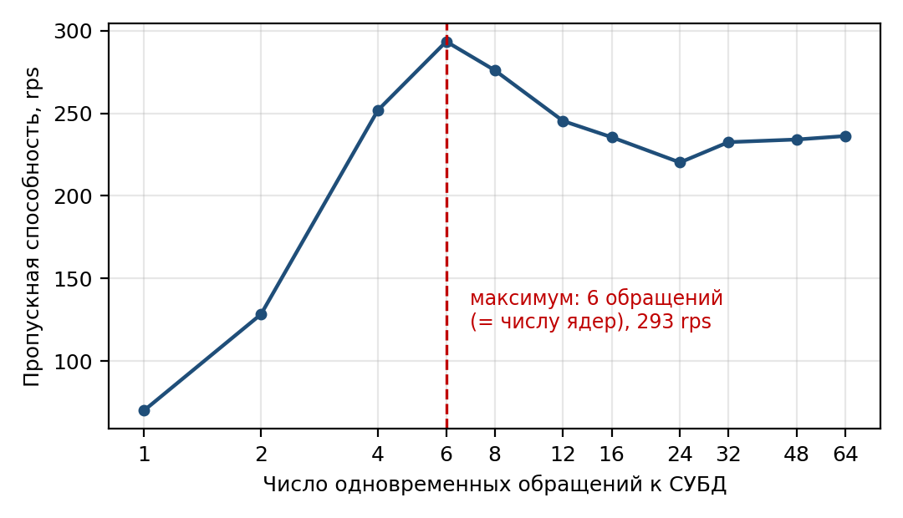
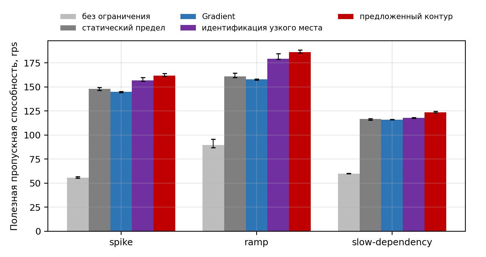
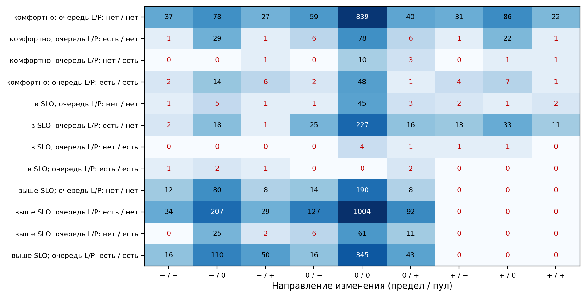
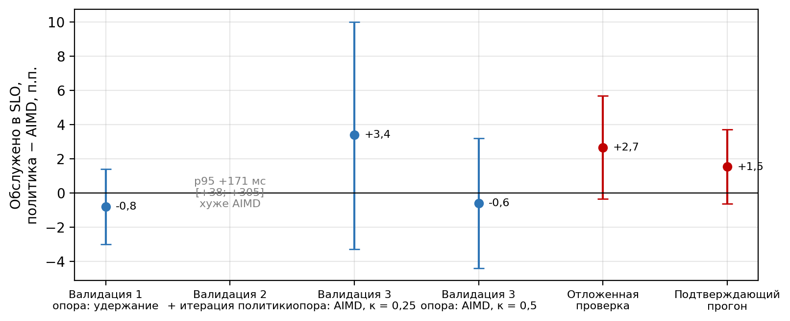
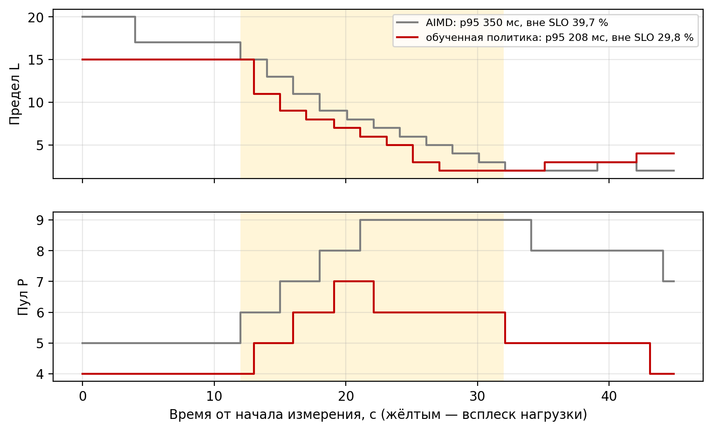
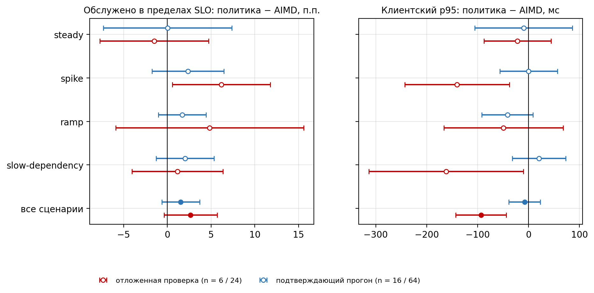

# ГЛАВА 4. ЭКСПЕРИМЕНТАЛЬНОЕ ИССЛЕДОВАНИЕ

## 4.1. Экспериментальный стенд и методика

Цель экспериментального исследования — проверить, улучшает ли обученная согласованная политика управление мягкими ресурсами по сравнению с настроенным базовым регулятором на реальной СУБД, и установить, в какой мере результат обусловлен согласованным управлением вторым ресурсом. Исследование выполнено на нагрузочном стенде модуля `iasr-benchmark`.

**Приложение.** Тестовое приложение Spring Boot имеет единственный бизнес-эндпоинт. Обработчик берёт соединение из пула HikariCP, выполняет запрос к PostgreSQL — суммирование по сгенерированному ряду, стоимость которого задаётся числом строк, — освобождает соединение и выполняет короткую работу в процессе. Запросы выполняют настоящую вычислительную работу в СУБД, а не ожидают таймер: ожидающая зависимость ни за что не конкурирует и показала бы плато пропускной способности там, где работающая показывает спад.

**Калибровка зависимости.** Перед экспериментами пропускная способность PostgreSQL была измерена при фиксированной конкурентности замкнутым циклом (рисунок [@fig:calib]). Максимум достигается при числе одновременных обращений, равном числу выделенных ядер, — величине, которую никто не задавал в настройках стенда; при десятикратном превышении оптимума пропускная способность составляет около 80 % пика. Калибровка подтверждает унимодальность целевой функции (раздел 2.1) и показывает, что размер пула нельзя выставить «побольше на всякий случай». Отдельно калибровка показала, что синтетическая модель зависимости, использовавшаяся на раннем этапе, штрафовала избыточную конкурентность почти на порядок сильнее реальной СУБД; поэтому все итоговые результаты получены на PostgreSQL.

{#fig:calib width=14}

**Нагрузка.** Генератор нагрузки работает в открытом цикле: запросы отправляются с заданной интенсивностью независимо от того, справляется ли сервер. Закрытый цикл сам себя ограничивает при замедлении сервера, и перегрузка при таком измерении не наступает. Задержка отсчитывается от момента, когда запрос должен был быть отправлен, а не когда был отправлен фактически; это устраняет искажение, при котором отставание клиента маскируется под улучшение перцентилей (coordinated omission). Клиент ждёт ответа не более 3 с; такие запросы считаются жёсткими отказами.

**Сценарии.** Каждый сценарий построен вокруг способа, которым фиксированная настройка оказывается неправильной:

- steady — постоянная нагрузка внутри ёмкости в течение 30 с; проверка того, что контур не вредит в норме;
- spike — базовая нагрузка, затем трёхкратный всплеск на 20 с (с 12-й по 32-ю секунду) и возврат; проверяются отклонение лишнего и возврат ёмкости;
- ramp — плавный рост нагрузки от значительно ниже до значительно выше ёмкости за 45 с;
- slow-dependency — постоянная нагрузка, но с 15-й по 35-ю секунду время запроса к СУБД увеличивается в заданное число раз (множитель деградации); правильные значения ресурсов до и во время деградации различаются более чем вдвое.

Интенсивности сценариев умножаются на масштаб нагрузки условия. Каждому эпизоду предшествует прогрев 6 с.

**Условия.** Условие стенда задаётся пятью параметрами: временем запроса к СУБД, масштабом нагрузки, стартовым размером пула, стартовым пределом конкурентности и множителем деградации. Условия разделены на четыре обучающих, одно валидационное и два отложенных (таблица [@tbl:conditions]). Общие параметры: PostgreSQL 17 во временном кластере, создаваемом для каждого плана, SLO 150 мс, окно управления 1 с, предел конкурентности 2–400, пул 2–16.

Таблица: Условия стенда для согласованной политики {#tbl:conditions}
| Параметр | Обучение (a, b, c, d) | Валидация | Отложенная проверка | Подтверждающий прогон |
|---|---|---|---|---|
| Время запроса к СУБД, мс | 16, 20, 12, 24 | 18 | 14 | 22 |
| Масштаб нагрузки | 0,40; 0,50; 0,60; 0,32 | 0,45 | 0,55 | 0,42 |
| Стартовый пул | 4, 8, 12, 3 | 6 | 5 | 7 |
| Стартовый предел | 12, 24, 16, 8 | 14 | 20 | 10 |
| Множитель деградации | 2,25; 2,0; 2,5; 1,8 | 2,2 | 2,4 | 2,1 |

**Порядок измерений.** Эпизоды выполняются блоками «сценарий × повтор», внутри которых сравниваемые режимы следуют в перемешанном и циклически сдвигаемом порядке. Необходимость этого установлена измерением. На раннем этапе стенд выполнял все повторы одного режима подряд, и прогон растянулся на 21 час; одна и та же конфигурация Gradient измерилась как 70,9 запроса/с в одном окне времени и 114,7 в другом. Расхождение в 62 % при неизменных настройках превышало любой эффект, который стенд должен разрешать, и прогон был забракован целиком. При чередовании дрейф условий сдвигает все режимы вместе и сокращается в парной разности.

**Отрицательный контроль.** В сериях с базовым регулятором режимы `gradient` и `gradient-pinned` представляют одну и ту же конфигурацию: регулятор Gradient не управляет пулом. Разница между ними — чистая ошибка измерения, задающая порог различимости стенда. Он составил 0,6; 2,6 и 0,2 % по пропускной способности в трёх стрессовых сценариях, поэтому различия меньше примерно 3 % на этом стенде не заявлялись.

**Статистика.** В серии базового регулятора (7 повторов) использовались медианы и бутстрэп-интервалы 95 % {efron}, а различие признавалось только при непересекающихся интервалах. В сериях обученной политики используется парный дизайн: для каждой пары «сценарий × повтор» вычисляется разность показателя между режимами, и строится 95-процентный интервал Стьюдента для средней разности по парам. Поправка на множественность не применяется; поэтому значимым признаётся только основной показатель и заранее заданные контрасты, а остальные показатели приводятся как описательные.

**Протокол.** Для каждой серии до запуска фиксировался план в формате JSON: режимы, условия, число повторов, зерно генератора порядка, основной показатель и метод интервалов. План и код коммитились в репозиторий, а инструмент запуска записывал SHA-256 плана и версию кода в метаданные прогона.

## 4.2. Показатели

Основной показатель — доля отправленных запросов, получивших успешный ответ в пределах SLO (обслужено в SLO, %). Это клиентский эквивалент критерия [@eq:served] и вознаграждения [@eq:reward]. Описательные показатели:

- полезная пропускная способность (goodput) — успешные ответы в секунду;
- p95 и p99 задержки успешных ответов на стороне клиента, мс;
- доля успешных ответов позже SLO (вне SLO, %);
- доля отклонённых фильтром допуска запросов (429, %) и доля жёстких отказов.

Перцентили считаются только по успешным ответам. Поэтому рядом всегда приводятся доли отклонений: без них режим с агрессивным отклонением выглядел бы лучшим, просто исключив медленные запросы из выборки. Основной показатель учитывает обе стороны: отклонённый запрос и запрос, обслуженный позже SLO, одинаково не засчитываются.

## 4.3. Результаты базового регулятора и прототипа обучаемой политики

Предварительный этап исследования, результаты которого подготовлены к публикации, был посвящён правилам базового регулятора и вкладу управления вторым ресурсом. Он выполнен на PostgreSQL 16 в контейнере с шестью ядрами: четыре сценария, семь режимов, семь повторов, 196 запусков; стартовый пул — 4 соединения при оптимуме 6. Результаты по полезной пропускной способности показаны на рисунке [@fig:aimd].

{#fig:aimd width=16}

Основные выводы этого этапа:

1) Наибольший эффект даёт сам факт ограничения конкурентности. Без него перегрузка обрушивает сервис: 60–77 % запросов не получают ответа, а статический предел увеличивает полезную пропускную способность на 80–166 %. Поэтому выигрыш адаптивного управления оценивается относительно статического предела или другого адаптивного регулятора, а не относительно режима без ограничения.

2) Правила управления пределом конкурентности не превосходят алгоритм Netflix Gradient: при закреплённом пуле у обоих регуляторов разности составили −0,5; −2,3 и +0,2 % — в пределах отрицательного контроля.

3) Разрешение управлять пулом соединений при прочих равных увеличило полезную пропускную способность на 11,6; 17,7 и 6,4 % в сценариях spike, ramp и slow-dependency при одновременном снижении p95 и доли отклонённых запросов. Механизм виден в траекториях: однорессурсный регулятор не видит, что узким местом является пул, и компенсирует это снижением предела, тогда как согласованный контур увеличивает пул.

4) Регулятор с идентификацией узкого места, точно выводящий пул к оптимуму 6, проиграл простым независимым правилам 3,2–4,8 % пропускной способности: правила увеличивали пул до 10–13, выше оптимума, но быстрее. Данные согласуются с гипотезой, что в переходном режиме нехватка соединений обходится дороже последующего избытка; отдельно эта гипотеза не проверялась.

Эти числа получены до введения контракта метрик (раздел 3.3) и сравниваются только между собой.

После этого был разработан и проверен прототип обучаемой политики — FQI версий 1 и 2 (раздел 2.8). Его результаты сведены в таблицу [@tbl:prototype].

Таблица: Результаты прототипа обучаемой политики (FQI версий 1–2) на PostgreSQL {#tbl:prototype}
| Серия | Сравнение | Δ goodput, запр./с | Δ p95, мс |
|---|---|---|---|
| Перенос модели, 4 блока | FQI − AIMD | −2,70 [−14,21; +8,81] | +251,5 [−705,7; +1208,7] |
| Абляция координации, 4 блока | полная FQI − FQI с пулом 5 | +5,93 [−5,02; +16,87] | −156,75 [−300,20; −13,30] |
| | полная FQI − аддитивная FQI | +0,70 [−2,14; +3,54] | +3,25 [−94,54; +101,04] |
| | полная FQI − AIMD | +0,30 [−2,09; +2,69] | +64,25 [−13,56; +142,06] |
| Пул 12, spike | полная FQI − AIMD | −1,23 [−9,82; +7,37] | +10,00 [−57,71; +77,71] |
| Пул 12, ramp | полная FQI − AIMD | +4,70 [−20,29; +29,69] | +75,00 [−197,94; +347,94] |
| Конкуренция за CPU, без нагрузки | FQI − AIMD | −2,25 [−4,46; −0,04] | +82,75 [−67,51; +233,01] |

Прототип подтвердил полезность координации внутри обученной политики: при дефиците пула свободный пул снижал p95 во всех четырёх блоках относительно той же модели с закреплённым пулом. Однако настроенный AIMD прототип не превзошёл ни в одной серии, а в отложенном сравнении после переноса модели решение в 128 из 176 окон принимал резервный регулятор из-за отсутствия поддержки. Полная совместная Q-функция не отличалась от аддитивной по goodput и p95, хотя применяла больше совместных изменений. Эти результаты стали основанием для переработки метода, описанной в главе 2.

## 4.4. Обучение согласованной политики и выбор правила решения

Обучающие данные версии 3 собраны по одному плану за 90 минут: 92 эпизода на четырёх обучающих условиях и одном валидационном. На каждом обучающем условии записаны эпизоды исследующей политики с якорем на базовом регуляторе и на удержании и эпизоды базового регулятора. Получено 3646 обучающих и 550 валидационных переходов; в данных представлены все девять направлений совместного изменения.

Покрытие итоговых обучающих данных по видам состояния и направлениям изменения показано на рисунке [@fig:support]. Из 108 клеток таблицы поддержки порог m_s = 8 достигнут в 44. Данные хорошо покрывают два крайних режима — спокойный без очередей и перегрузку с очередью за разрешением, — а промежуточная зона «p95 в пределах SLO, но выше 0,7·S» представлена слабо: в ней задержка находится в узком интервале 105–150 мс. Увеличение предела при нарушении SLO в данных отсутствует, поскольку оно запрещено ограничителем и не может быть предложено ни исследующей, ни обученной политикой. В виде состояния с недостаточной поддержкой политика по свойству 3 следует базовому регулятору.

{#fig:support width=16}

Последовательность моделей и проверок в замкнутом контуре на валидационном условии показана на рисунке [@fig:valseq] и в таблице [@tbl:valseq].

Таблица: Последовательность моделей и валидационных проверок {#tbl:valseq}
| Шаг | Изменение метода | Результат на валидации (политика − AIMD) |
|---|---|---|
| Модель 1 | один регрессор, опора — удержание, κ = 0 | обслужено в SLO −0,8 п.п. [−3,0; +1,4]; модель принимала 96 % решений, лишние изменения в спокойном режиме |
| — | разложение Q = V + A, нижняя граница, κ = 0,2 | признаки действия вошли в число важных; сомнительные изменения отсекаются |
| Итерация политики | 16 эпизодов под управлением модели на обучающих условиях | на двух условиях лучше AIMD, на двух хуже: застревание на высоком пределе под перегрузкой |
| Модель 2 | + эпизоды итерации политики | p95 +171 мс [+38; +305] — хуже AIMD |
| Модель 3 | опора — предложение AIMD (SPIBB), κ ∈ {0,25; 0,5} | κ = 0,25: +3,4 п.п. [−3,3; +10,0]; κ = 0,5: −0,6 п.п. [−4,4; +3,2]; выбрано κ = 0,25 |

{#fig:valseq width=16}

Главный вывод этого этапа — выбор действия по умолчанию определяет результат сильнее, чем точность модели. Модель, сравнивающая кандидатов с удержанием, при неуверенности бездействует, и под перегрузкой это хуже, чем быстрая реакция правил. Модель, сравнивающая кандидатов с предложением правил, при неуверенности повторяет правила. Это наблюдение и привело к правилу принятия решения раздела 2.6.

Итоговая модель обучена на 4375 переходах: 1455 — исследующей политики с якорем на правилах, 1458 — с якорем на удержании, 733 — базового регулятора и 729 — итерации политики. Ошибка Беллмана (среднеквадратичная) составила 0,57 на обучающих и 0,85 на валидационных переходах при среднем вознаграждении 0,46 и 0,40 соответственно. Наиболее важные признаки регрессора преимущества приведены в таблице [@tbl:importance]: первые места занимают ёмкости ресурсов до и после действия, то есть модель действительно различает действия.

Таблица: Важность признаков регрессора преимущества A (десять первых) {#tbl:importance}
| Признак | Тип | Важность |
|---|---|---|
| размер пула после действия | действие | 0,053 |
| предел конкурентности | состояние | 0,052 |
| предел конкурентности после действия | действие | 0,047 |
| занятость пула за окно | состояние | 0,046 |
| размер пула | состояние | 0,045 |
| доля отклонённых за окно | состояние | 0,042 |
| сглаженное ожидание разрешения относительно SLO | состояние | 0,040 |
| нагрузка на предел после действия | действие | 0,038 |
| сглаженная занятость пула | состояние | 0,038 |
| занятость предела за окно | состояние | 0,035 |

**Отступление от протокола.** План отложенной проверки был зафиксирован до первого обучения. Правило принятия решения (опора на предложение правил, разложение V + A, значение κ) выбрано позже, по результатам валидации, но до запуска отложенной проверки; на отложенном условии ничего не настраивалось. Это отступление отмечено в отчёте и является одной из причин, по которым был проведён подтверждающий прогон с планом, зафиксированным после выбора метода.

## 4.5. Отложенная проверка

Отложенная проверка выполнена по зафиксированному плану на условии, не использовавшемся при обучении и выборе метода: три режима — базовый регулятор (AIMD), обученная политика и обученная политика с закреплённым пулом, — четыре сценария, шесть повторов, всего 72 эпизода. Средние значения показателей приведены в таблице [@tbl:eval].

Таблица: Результаты отложенной проверки (средние по 6 повторам) {#tbl:eval}
| Сценарий | Режим | Обслужено в SLO, % | Goodput, запр./с | p95, мс | p99, мс | Вне SLO, % | 429, % |
|---|---|---|---|---|---|---|---|
| steady | AIMD | 95,56 | 64,48 | 77,2 | 342,3 | 2,25 | 2,32 |
| | политика | 94,06 | 62,98 | 55,5 | 241,2 | 1,57 | 4,62 |
| | политика, пул закреплён | 89,51 | 60,70 | 155,5 | 484,3 | 2,95 | 8,05 |
| spike | AIMD | 27,54 | 55,40 | 351,8 | 1096,5 | 32,90 | 58,77 |
| | политика | 33,70 | 54,45 | 211,5 | 796,7 | 16,05 | 59,47 |
| | политика, пул закреплён | 35,42 | 69,70 | 234,3 | 685,3 | 29,33 | 48,13 |
| ramp | AIMD | 30,08 | 61,48 | 309,2 | 1110,5 | 24,13 | 60,07 |
| | политика | 34,92 | 67,55 | 260,0 | 804,8 | 19,92 | 56,13 |
| | политика, пул закреплён | 27,14 | 53,92 | 258,5 | 915,5 | 21,95 | 64,98 |
| slow-dependency | AIMD | 31,40 | 37,23 | 509,3 | 1549,3 | 30,38 | 54,90 |
| | политика | 32,54 | 36,62 | 347,5 | 1611,8 | 26,68 | 55,62 |
| | политика, пул закреплён | 28,48 | 35,73 | 394,5 | 1450,8 | 35,47 | 56,70 |
| все | AIMD | 46,15 | 54,65 | 311,9 | 1024,7 | 22,42 | 44,01 |
| | политика | 48,81 | 55,40 | 218,6 | 863,6 | 16,05 | 43,96 |
| | политика, пул закреплён | 45,14 | 55,01 | 260,7 | 884,0 | 22,43 | 44,47 |

Жёстких отказов не было ни в одном режиме. Парные разности «политика минус AIMD» приведены в таблице [@tbl:evaldiff].

Таблица: Парные разности «политика − AIMD» в отложенной проверке, 95 % интервалы Стьюдента {#tbl:evaldiff}
| Область | Обслужено в SLO, п.п. | Goodput, запр./с | p95, мс |
|---|---|---|---|
| все сценарии, n = 24 | +2,66 [−0,36; +5,69] | +0,75 [−4,41; +5,91] | −93,3 [−142,9; −43,6] |
| steady | −1,50 [−7,70; +4,70] | −1,50 [−4,82; +1,82] | −21,7 [−87,6; +44,3] |
| spike | +6,16 [+0,57; +11,75] | −0,95 [−9,17; +7,27] | −140,3 [−242,8; −37,8] |
| ramp | +4,84 [−5,89; +15,56] | +6,07 [−18,72; +30,85] | −49,2 [−166,2; +67,9] |
| slow-dependency | +1,15 [−4,04; +6,34] | −0,62 [−4,09; +2,86] | −161,8 [−313,8; −9,9] |

По всем сценариям доля ответов вне SLO снизилась на 6,36 п.п. [−11,49; −1,23], p99 — на 161 мс [−371; +49], доля отклонённых запросов не изменилась: −0,05 п.п. [−3,65; +3,54]. Таким образом, на этом условии обученная политика статистически значимо сократила хвост задержки, не увеличив отклонений. Основной показатель вырос на 2,66 п.п., но интервал включает ноль.

Вклад согласованности оценён сравнением с той же политикой, у которой пул закреплён на значении AIMD. Политика с закреплённым пулом базовый регулятор не превосходит: −1,01 п.п. [−5,25; +3,24] по основному показателю. Разность «полная политика минус политика с закреплённым пулом» составила +3,67 п.п. [−0,35; +7,69] — направление в пользу согласованного управления, но интервал включает ноль.

Характеристики работы политики приведены в таблице [@tbl:behaviour]. Политика отступала от предложения AIMD в 16 % окон, из 127 изменений ресурсов, выполненных моделью, 25 были совместными. Максимальное время решения составило 4,4 мс при бюджете 20 мс. Переходов на резерв из-за ошибки модели или бюджета не было. Повторное вычисление по журналу подтвердило решения политики в 1961 окне без отступления; для окон отступления выполнена проверка согласованности (раздел 3.9).

Таблица: Работа политики в отложенной проверке {#tbl:behaviour}
| Режим | Окна | Решения модели | Отступления от AIMD | Изменения ресурсов моделью | Из них совместные | Макс. время решения, мс |
|---|---|---|---|---|---|---|
| политика | 1166 | 1118 | 182 (16 %) | 127 | 25 | 4,43 |
| политика, пул закреплён | 1169 | 1120 | 95 (8 %) | 80 | 0 | 0,82 |

Механизм улучшения хвоста виден в траекториях. На рисунке [@fig:traj] показан эпизод сценария spike из одного блока для обоих режимов. При начале всплеска политика снижает предел быстрее AIMD и удерживает пул на 6–7 соединениях, тогда как AIMD увеличивает пул до 9. Это согласуется с выводом предварительного этапа о том, что правила AIMD увеличивают пул выше оптимума зависимости: при перегрузке СУБД больший пул переносит очередь внутрь базы и удлиняет время обслуживания. Различие стартовых значений в начале измерения объясняется действиями регуляторов во время прогрева.

{#fig:traj width=16}

## 4.6. Оценка мощности и подтверждающий прогон

Чтобы решить, можно ли установить эффект по основному показателю, выполнена оценка мощности по парным разностям отложенной проверки {cohen}. Использовался двусторонний парный t-критерий с уровнем значимости 0,05; мощность вычислялась по нецентральному распределению Стьюдента (таблица [@tbl:power]).

Таблица: Оценка мощности по данным отложенной проверки {#tbl:power}
| Показатель | Средняя разность | Стандартное отклонение разностей | Мощность при 24 парах | Пар для 80 % | Пар для 90 % |
|---|---|---|---|---|---|
| Обслужено в SLO, п.п. | +2,66 | 7,16 | 0,41 | 59 | 79 |
| p95, мс | −93,3 | 117,7 | — | 15 | 19 |

Отложенная проверка имела мощность около 40 % для наблюдённого эффекта по основному показателю, поэтому отсутствие значимости ожидаемо и само по себе не означает отсутствия эффекта. Для p95 мощности было достаточно с запасом. Разброс разностей внутри сценария (6,93 п.п.) почти не меньше общего, поэтому группировка по сценариям выигрыша не даёт.

На основании этой оценки был спланирован подтверждающий прогон: та же модель (SHA-256 `7bab1535…`) и то же правило решения, новое отложенное условие (таблица [@tbl:conditions]), режимы AIMD и политика, 16 повторов × 4 сценария = 64 пары. План был закоммичен до запуска вместе с оценкой мощности. Критерий подтверждения задан заранее: 95-процентный интервал парной разности основного показателя, объединённой по сценариям, не должен включать ноль; остальные показатели — описательные. Прогон выполнен на закоммиченном коде; 128 эпизодов заняли около 1 ч 45 мин.

Новое условие оказалось тяжелее для стенда: AIMD обслуживает в пределах SLO 35 % нагрузки против 46 % в первой проверке, доля отклонённых запросов — 57 % против 44 %. Результаты приведены в таблицах [@tbl:confirm] и [@tbl:confirmdiff] и на рисунке [@fig:paired].

Таблица: Результаты подтверждающего прогона (средние по 16 повторам) {#tbl:confirm}
| Сценарий | Режим | Обслужено в SLO, % | Goodput, запр./с | p95, мс | p99, мс | Вне SLO, % | 429, % |
|---|---|---|---|---|---|---|---|
| steady | AIMD | 64,08 | 36,46 | 267,8 | 966,8 | 12,08 | 27,68 |
| | политика | 64,11 | 36,05 | 258,0 | 1072,9 | 10,88 | 28,51 |
| spike | AIMD | 28,12 | 32,54 | 233,9 | 1003,3 | 11,27 | 68,31 |
| | политика | 30,48 | 35,08 | 234,0 | 987,2 | 11,03 | 65,84 |
| ramp | AIMD | 24,56 | 32,88 | 238,9 | 1103,4 | 11,99 | 72,03 |
| | политика | 26,26 | 34,14 | 197,2 | 950,0 | 9,73 | 70,96 |
| slow-dependency | AIMD | 23,31 | 25,61 | 277,8 | 1256,9 | 42,68 | 59,37 |
| | политика | 25,35 | 26,79 | 298,3 | 1215,4 | 40,93 | 57,47 |
| все | AIMD | 35,02 | 31,87 | 254,6 | 1082,6 | 19,50 | 56,85 |
| | политика | 36,55 | 33,02 | 246,9 | 1056,4 | 18,14 | 55,69 |

Таблица: Парные разности «политика − AIMD» в подтверждающем прогоне, 95 % интервалы Стьюдента {#tbl:confirmdiff}
| Область | Обслужено в SLO, п.п. | Goodput, запр./с | p95, мс |
|---|---|---|---|
| все сценарии, n = 64 | +1,53 [−0,63; +3,70] | +1,14 [−0,34; +2,63] | −7,7 [−38,6; +23,2] |
| steady | +0,03 [−7,30; +7,35] | −0,41 [−3,38; +2,56] | −9,8 [−105,6; +86,1] |
| spike | +2,36 [−1,74; +6,47] | +2,54 [−1,27; +6,34] | +0,1 [−56,4; +56,5] |
| ramp | +1,70 [−1,01; +4,42] | +1,26 [−2,30; +4,82] | −41,6 [−91,8; +8,6] |
| slow-dependency | +2,04 [−1,27; +5,35] | +1,19 [−1,02; +3,39] | +20,6 [−32,1; +73,2] |

{#fig:paired width=16.5}

По всем сценариям доля ответов вне SLO изменилась на −1,36 п.п. [−3,27; +0,55], p99 — на −26 мс [−126; +73], доля отклонённых запросов — на −1,15 п.п. [−3,08; +0,78]; жёстких отказов не было. Политика приняла 2996 решений в 3136 окнах, отступила от предложения AIMD в 403 окнах (13 %), выполнила 294 изменения ресурсов, из них 44 совместных. Переходы на резерв были вызваны только короткой историей (67), нерегулярным окном (64) и простоем (9); по бюджету времени и ошибке модели — ни одного. Максимальное время решения — 1,99 мс. Повторное вычисление по журналу подтвердило 2593 решения без отступления; окна отступления прошли проверку согласованности.

Таблица: Работа политики в подтверждающем прогоне {#tbl:behaviour2}
| Показатель | Значение |
|---|---|
| Окна | 3136 |
| Решения модели | 2996 |
| Отступления от AIMD | 403 (13 %) |
| Изменения ресурсов моделью | 294 |
| Из них совместные | 44 |
| Переходы на резерв: короткая история / нерегулярное окно / простой | 67 / 64 / 9 |
| Переходы на резерв: бюджет / ошибка модели | 0 / 0 |
| Максимальное время решения, мс | 1,99 |

Доля отступлений от правил в подтверждающем прогоне (13 %) близка к первой проверке (16 %), то есть политика вела себя сходно; различие результатов связано с условием, а не с изменением поведения модели. Траектории показывают, чем различаются условия. В подтверждающем прогоне предел конкурентности находился на минимальном значении 2 в 68–69 % отсчётов у обоих регуляторов, тогда как в первой проверке — в 27 % (AIMD) и 34 % (политика). Когда предел большую часть времени упирается в нижнюю границу, решения о нём у обоих регуляторов совпадают, и пространство для улучшения хвоста задержки за счёт предела невелико. Различие в управлении пулом сохраняется на обоих условиях: средний размер пула под управлением политики составил 4,6 и 4,5 соединения против 6,5 и 6,4 у AIMD.

**Заранее заданный критерий подтверждения не выполнен**: интервал разности основного показателя +1,53 п.п. [−0,63; +3,70] включает ноль. Оценка эффекта меньше, чем в первой проверке, и мощности 64 пар для неё недостаточно. Знак разности по основному показателю положителен во всех четырёх сценариях обоих прогонов, что согласуется с небольшим положительным эффектом, но статистически его не устанавливает. Снижение хвоста задержки, значимое в первой проверке, на втором условии не воспроизвелось: −7,7 мс [−38,6; +23,2]. Следовательно, результат по p95 следует описывать как полученный на одном условии из двух, а не как общий.

Дальнейшие прогоны с целью достичь значимости не проводились: повторение проверок до получения нужного результата превратило бы подтверждение в поиск и обесценило бы заранее зафиксированный критерий. Эксперименты с версией 3 заморожены.

## 4.7. Угрозы валидности

**Внутренняя валидность.** Правило принятия решения выбрано после фиксации плана первой отложенной проверки (раздел 4.4); подтверждающий прогон устраняет эту угрозу для своего результата, поскольку его план зафиксирован после выбора метода. Интервалы не скорректированы на множественность; значимыми признаются только основной показатель и заранее заданные контрасты. Выбор κ сделан по одному валидационному условию с двумя повторами на сценарий, то есть по восьми парам, и мог быть неоптимальным.

**Полнота журнала.** В окнах, где обученная политика отступила от правил, журнал хранит её решение вместо предложения AIMD. Это ограничивает проверку решений по журналу окнами без отступления (раздел 3.9), а в 729 переходах итерации политики делает действием опоры в цели Беллмана фактически выполненное действие. На результаты сравнения режимов это не влияет, поскольку показатели измеряются клиентом, но проверка соответствия реализации описанию метода для окон отступления опирается только на модульные тесты.

**Нестационарность стенда.** Нагрузка, приложение и СУБД работают на одном хосте (10 ядер, macOS). На предварительном этапе наблюдался дрейф между блоками: в серии с CPU-нагрузкой знак эффекта воздействия менялся между первыми и последними блоками, а в серии с пулом 12 средний goodput снижался от первого блока к четвёртому. Блоковый дизайн с чередованием режимов уменьшает влияние дрейфа на парные разности, но не устраняет его. Разброс результатов одного режима между прогонами на соседних условиях составляет порядка ±4 п.п. основного показателя, что сопоставимо с изучаемым эффектом.

**Валидность измерения.** Генератор нагрузки работает в той же JVM, что и приложение, и под сильной перегрузкой конкурирует с ним за процессор; абсолютные значения при этом занижены, но условия одинаковы для всех режимов. Метрики приложения не включают сеть и очередь сервлет-контейнера, поэтому основным показателем выбран клиентский. Определения метрик менялись между этапами исследования (раздел 3.3), поэтому результаты разных этапов сравниваются только внутри этапа.

**Внешняя валидность.** Проверены одна СУБД, один тип запроса и два мягких ресурса; два отложенных условия различаются нагрузкой и стоимостью запроса, но относятся к одному объекту. Перенос на другие приложения, зависимости и ресурсы (например, пулы потоков) не проверялся. Объём обучающих данных — 4375 переходов — мал по меркам обучения с подкреплением; устойчивость замкнутой системы с обученной политикой формально не доказана.

## 4.8. Обсуждение результатов

Результаты исследования можно разделить на установленные, не установленные и отрицательные.

**Установлено.** Обученная политика, принимающая решения относительно предложения базового регулятора, работает в замкнутом контуре реального приложения как режим библиотеки: решения занимают единицы миллисекунд, переходов на резерв из-за ошибок модели или бюджета времени не было, решения JVM совпадают с эталонной реализацией на эталонных окнах, а по журналам подтверждены все решения без отступления от правил. Ухудшения основного показателя относительно базового регулятора не обнаружено ни на одном из двух отложенных условий: точечные оценки +2,66 и +1,53 п.п., нижние границы интервалов −0,36 и −0,63 п.п., то есть ухудшение более чем на 0,6 п.п. исключено с доверительной вероятностью 95 %. Это соответствует цели метода безопасного улучшения: где данных недостаточно, поведение совпадает с правилами. На первом отложенном условии политика значимо сократила хвост задержки: p95 на 93 мс, долю ответов вне SLO на 6,4 п.п. без роста отклонений.

**Не установлено.** Превосходство обученной политики над базовым регулятором по основному показателю не подтверждено двумя отложенными проверками, включая заранее спланированный подтверждающий прогон. Снижение хвоста задержки не воспроизвелось на втором условии. Вклад согласованного управления пулом внутри обученной политики направлен в ожидаемую сторону (+3,67 п.п. относительно политики с закреплённым пулом), но не значим.

**Отрицательные результаты.** Прототип с 208 сырыми признаками и поддержкой по расстоянию не превзошёл AIMD и большую часть времени работал на резерве. Обученная политика с удержанием в качестве действия по умолчанию оказалась хуже правил под перегрузкой (p95 +171 мс на валидации). Эти результаты показывают, что для offline-обучения на данном объёме данных выбор действия по умолчанию и представление состояния важнее точности аппроксимации.

Сопоставление с предварительным этапом объясняет, почему эффект обученной политики невелик. Основной выигрыш согласованного управления — увеличение пула при его дефиците — уже реализован правилами базового регулятора, и обученная политика улучшает правила лишь в части их известных слабостей: избыточного роста пула под перегрузкой СУБД и отсутствия различения ожидания допуска и времени обслуживания. Величина возможного улучшения в таких условиях ограничена, и для её надёжной оценки на данном стенде требуется больше пар, чем было запланировано, или стенд с меньшим разбросом.

## Выводы по главе 4

1. Разработана методика экспериментальной проверки регуляторов мягких ресурсов на реальной СУБД: открытый цикл нагрузки без искажения перцентилей, клиентский основной показатель, чередование режимов, отрицательный контроль, парные интервалы, заранее фиксируемые планы с записью версии кода.

2. Согласованное управление пулом соединений при его дефиците даёт значимый выигрыш уже для правил базового регулятора (+6,4…+17,7 % полезной пропускной способности); прототип обучаемой политики этот регулятор не превзошёл.

3. Обученная согласованная политика версии 3 на первом отложенном условии значимо сократила p95 (−93 мс) и долю ответов вне SLO (−6,4 п.п.) без роста отклонений; основной показатель +2,7 п.п. не значим.

4. В подтверждающем прогоне с заранее зафиксированным критерием (64 пары) эффект по основному показателю составил +1,5 п.п. [−0,6; +3,7] — критерий не выполнен; снижение p95 не воспроизвелось. Превосходство обученной политики над настроенным базовым регулятором не установлено; ухудшения относительно него также не обнаружено.

5. Выбор действия по умолчанию — предложение базового регулятора, а не удержание — оказался определяющим для качества обученной политики.
